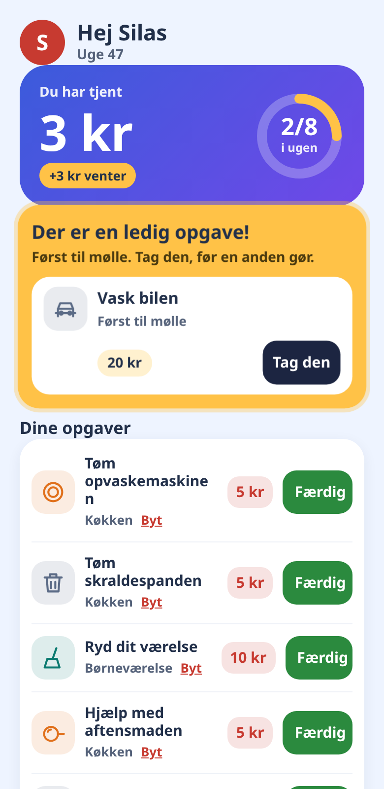
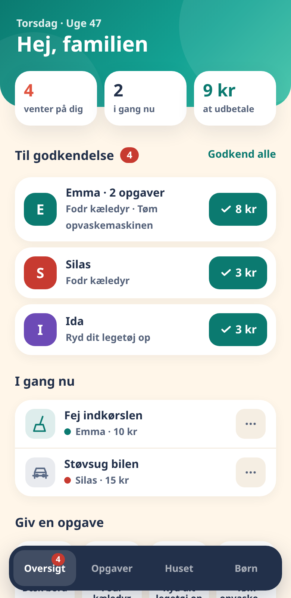
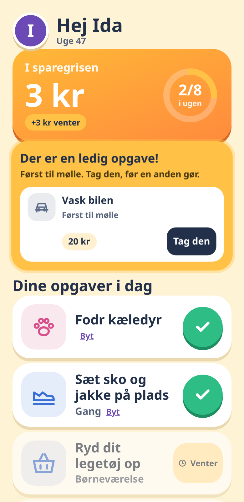
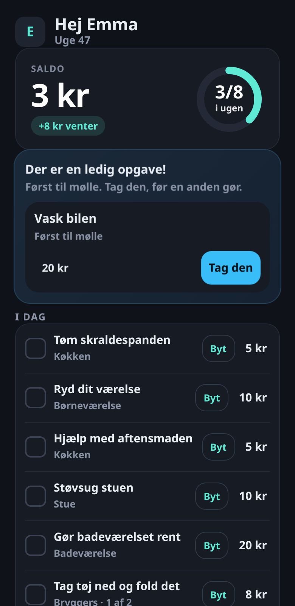
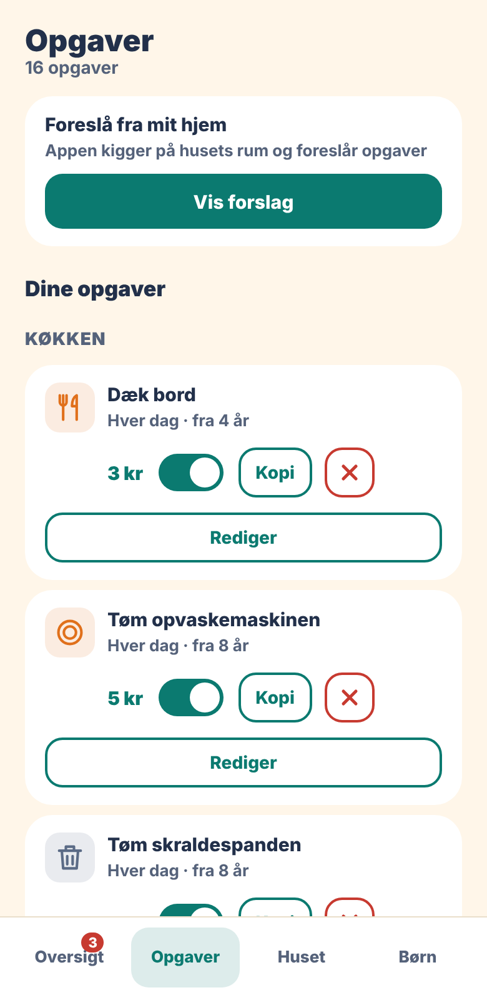
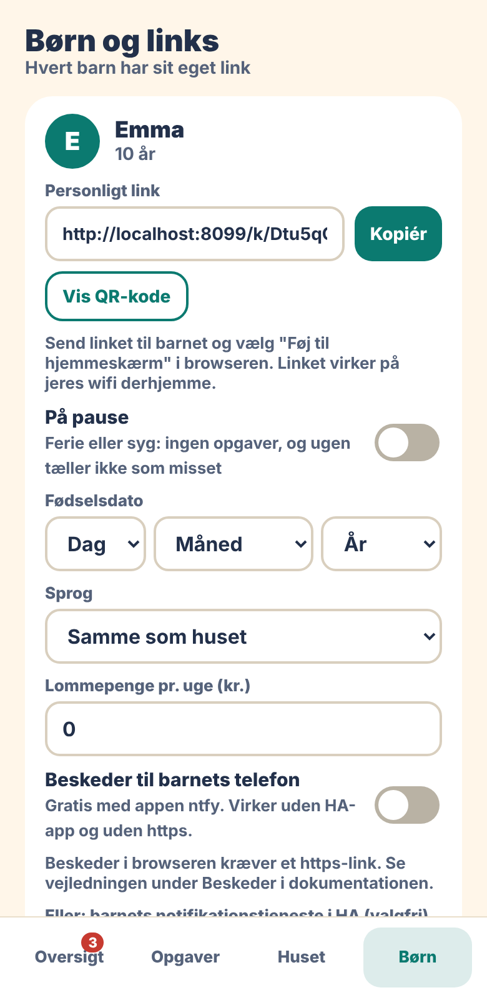
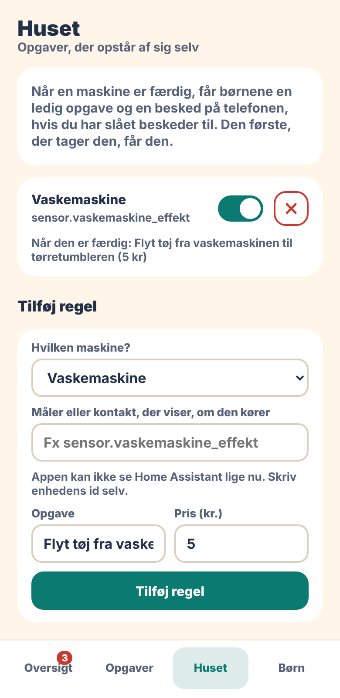

# Pligt-pilot

Pligter, penge og ønsker til hele familien, som en Home Assistant add-on.

Børnene åbner et personligt link på telefon eller tablet. Ingen HA-konto, ingen kodeord. Du godkender med ét tryk.

  
  

## Installation

1. I Home Assistant: **Indstillinger → Add-ons → Add-on butik → ⋮ → Repositories**.
2. Tilføj `https://github.com/Clahen86/Pligt-pilot`.
3. Installér **Pligt-pilot**, start den og åbn **Pligter** i sidemenuen.

Se `pligt-pilot/DOCS.md` for opsætning og indstillinger.

### Links der også virker ude (valgfrit)

Har du Nabu Casa (eller en adresse udefra til Home Assistant), kan børnenes og forældrenes links også virke væk hjemmefra, uden at åbne en port og stadig uden login:

1. Tilføj repo'et i HACS som **Custom repository** (type *Integration*) og installér **Pligt-pilot**. Genstart Home Assistant.
2. **Indstillinger → Enheder og tjenester → Tilføj integration → Pligt-pilot**. Den finder selv add-on'en.
3. Linkene starter nu med din Nabu Casa-adresse (`https://….ui.nabu.casa/pligter/…`). Send dem til børnene igen.

Uden Nabu Casa og uden adresse udefra virker linkene som før: kun hjemme.

## Det kan den

### Til børnene

- **Personligt link:** ingen login. Barnet kan scanne en QR-kode og lægge siden på startskærmen som en app. Siden viser selv en **Installer**-knap, når telefonen kan.
- **Tre tryk:** åbn, tryk på opgaven, tryk "Færdig". Hver opgave har et tydeligt ikon, så de mindste kan se, hvad den går ud på.
- **Ledige opgaver** står øverst i gult. Den første, der tager dem, får dem.
- **Rigtige kroner:** saldo, ugegraf, sparemål og ønsker. Et ønske kan blive til barnets sparemål med ét tryk.
- **Belønninger:** børnene kan bruge kroner på ting, du selv vælger, fx skærmtid eller fredagsfilm.
- **Spil og leg:** en fugl, der vokser fra æg til Pligtlegende, ugens boss som hele familien slår sammen, bonus for dage i træk og en overraskelsesopgave med dobbelt pris.
- **Bytte:** børn kan give en opgave til en søskende, evt. mod betaling.
- **Besked på telefonen** direkte fra linket, uden app og uden ekstra betaling.
- **Pligter** står med et rødt mærke og en frist, så barnet kan se, hvad der skal nås.
- **Maddage** fra Madplan med opskrift og ingredienser, som kan foldes ud.
- **Foreslå en opgave:** ser barnet noget, der skal laves, tager det et billede (eller skriver det). Du sætter navn og pris, og barnet får opgaven.
- **Sådan gør du:** hver opgave kan have en kort trin-for-trin-guide med "Færdig når …". AI'en i Home Assistant kan skrive den, med ekstra trin til de store (fx afkalkning).
- **Syg i dag:** barnet kan sige, at det er syg. Siger du ja, forsvinder dagens skoleopgaver (madpakke, skoletaske) uden træk.
- **Siden vokser med barnet:** legende med store billeder og en stor flueben-knap til de mindste (0–8 år), ryddelig til 9–12 år og mørk og enkel som en tjekliste fra 13 år. Det skifter selv med alderen, eller du vælger pr. barn.

  
  
  

### Til forældrene

  
  

- **Oversigt på ét blik:** hvad der venter på dig, hvad der er i gang, og hvad der skal udbetales. "Pr. måned" og "Seneste" er foldet væk, til du åbner dem.
- **Godkend pr. barn med ét tryk**, eller godkend alt på én gang. Tryk på barnet for at se og afvise de enkelte. Opgaver kan kræve et foto som bevis.
- **I gang nu** viser maskineopgaver og ledige opgaver, et barn har taget. Har et andet barn lavet den, giver du den videre med **Giv til**, eller du tager den tilbage med **Fjern**.
- **Giv en opgave med ét tryk:** hurtigknapper øverst på Oversigt med de mest brugte opgaver (eller dem, du har fastgjort). Hver knap viser **Alle** eller **Én**: en "Alle"-opgave (fx red din seng) sendes med ét tryk til hvert barn som deres egen; en "Én"-opgave (fx dæk bord) giver du til ét barn eller gør ledig for alle. Appen gætter ud fra navnet på 5 sprog, og du kan rette det på opgaven.
- **Fast eller kun når du giver den:** en fast opgave kommer af sig selv, evt. kun på faste ugedage (fx søndag) og først fra et bestemt klokkeslæt (**Frigives kl.**). En opgave, der står til "Kun når jeg giver den", ser børnene aldrig af sig selv, men den kan gives med hurtigknapperne.
- **Opsætning på få minutter:** en startpakke opretter opgaver, der passer til børnenes alder. Appen kan også foreslå opgaver ud fra husets rum og enheder.
- **Fleksible opgaver:** pris, gentagelse, flere gange om dagen, kun til bestemte børn, sæsonopgaver (fx løv om efteråret) og låsning efter alder, der åbner af sig selv, når barnet har fødselsdag.
- **Årstid og vejr af sig selv:** græs, hæk, løv, havemøbler og sne får selv de rigtige måneder og højst én gang om ugen (hæk hver 3. uge), ud fra titlen. Med en vejr-entity i Home Assistant venter udendørs opgaver på en tør dag, og sneopgaver kommer kun, når det har sneet.
- **Rimelighedstjek:** appen siger til, hvis en pris virker for høj eller for lav.
- **Pauseknap** pr. barn, lommepenge, træk for glemte opgaver, bonus for perfekt uge og udbetaling til alle med ét tryk.
- **Lommepenge med krav:** fra en valgt alder kræver lommepengene et antal godkendte opgaver i ugen. Ellers holdes de tilbage, og barnet får besked.
- **Pligter uden betaling:** send en pligt til et eller flere børn med en frist. Bliver den ikke lavet, trækkes et beløb.
- **Eget link til hver forælder**, så I begge kan styre alt fra telefonen uden at logge ind.
- **Søndagsopsummering, gode råd og backup** af al data.
- **Flere sprog:** dansk, engelsk, tysk, svensk og norsk. Hvert barn kan have sit eget sprog.

### Huset passer på

  

Når vaskemaskinen, tørretumbleren eller opvaskemaskinen er færdig, får børnene en ledig opgave og en besked, fx "Flyt tøj til tørretumbleren". Appen finder selv målerne i Home Assistant, og hvis navnene ikke passer, søger du den rigtige frem under **Brug en anden måler**. En lampe kan blinke grønt, når du godkender.

Tryk **Ret** på en regel for at ændre opgavens navn og pris.

Har ingen taget opgaven, forsvinder den igen, når lågen åbnes (med en dørsensor), når maskinen starter igen, eller efter nogle timer.

### Samspil med Hus-chat og Madplan

Er Hus-chat eller Madplan installeret, finder de hinanden selv (kræver integrationen Pligt-pilot). Tømmes en maskine i Hus-chat, forsvinder den ledige opgave her. Et barn får "Tag den i Pligter" i chatten i stedet for "Jeg tager den", så det tager opgaven her og får penge for den. Giver Madplan et barn en maddag, får barnet opgaven "Maddag: …" med opskriften. Pligt-pilot fyrer selv `pligt_pilot_task`, når en husopgave, maddag eller pligt tages, laves eller fjernes. Uden de andre apps virker alt som før.

## Eksisterende løsninger (undersøgt 17. nov. 2026)

KidsChores, ChoreOps, TaskMate og Choremander findes allerede til HA. De kræver typisk en HA-konto til børnene. Det er den forskel, vi bygger på.

## Samspil med andre projekter

Dette repo er selvstændigt og ændrer intet i Energy Pilot, Heat-pilot eller andre repos.

## Licens

MIT
